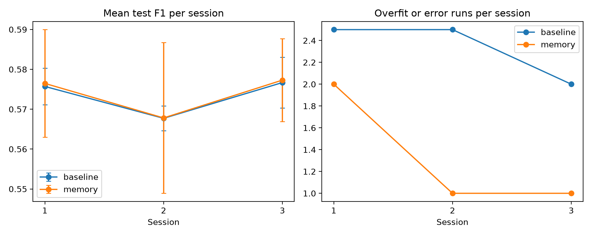

# Ninaivu

*Ninaivu* means "memory" in Tamil. Ninaivu is an ML lab notebook agent that remembers every training experiment, including the failures, and uses that memory to propose the next one. It is built on [Hindsight](https://github.com/vectorize-io/hindsight) agent memory.

## The problem

Training models means running dozens of experiments: different models, settings and features. Weeks later, nobody remembers what was tried, what failed and why. Teams repeat dead ends, and lessons leave when a teammate leaves.

## What it does

Ninaivu runs one loop:

1. **Recall** past experiments from Hindsight.
2. **Propose** the next configuration with an LLM (Groq, `openai/gpt-oss-20b`), given what was recalled.
3. **Run** it: a real scikit-learn training run on the Telco Customer Churn dataset from Kaggle.
4. **Retain** the configuration and its result, including overfitting and errors, back into Hindsight.

A Streamlit app lets you ask the stored memory questions and shows the memories behind each answer.

## How Hindsight is used

| Operation | Where | What it does here |
|---|---|---|
| `retain` | `agent.py`, `seed_demo_bank.py` | Stores every experiment (configuration, status, train and test F1) |
| `recall` | `agent.py`, `app.py` | Before each proposal in sessions 2 and 3, fetches earlier experiments; the app shows them as evidence |
| `reflect` | `app.py` | Answers questions such as "why should we drop the customerID column?" from stored experiments |

Each experiment trial uses its own memory bank, so trials never share memories.

## The experiment

- **Task:** predict churn on the Telco dataset. Metric: test F1 on the churn class.
- **Search space:** logistic regression, random forest or gradient boosting, with hyperparameters, an optional feature drop and optional scaling.
- **Sessions:** 3 sessions of 10 runs each. The agent's context is wiped between sessions, like returning to a project weeks later.
- **Memory agent:** recalls earlier experiments from Hindsight at the start of each run in sessions 2 and 3.
- **Baseline agent:** the same model and prompt, with no persistent memory.
- **Overfit:** a run is flagged when train F1 exceeds test F1 by more than 0.15.
- **Trials:** 2 per agent, 120 runs in total.

## Results

Across 2 trials per agent on `gpt-oss-20b` (120 runs, 0 fallbacks), the two agents scored the same. Mean test F1 was 0.573 for the baseline and 0.574 for the memory agent, and no session differed by more than 0.001.

The memory agent made fewer overfit or error runs in sessions 2 and 3: 4 of 40 runs, against 9 of 40 for the baseline. In session 1, where neither agent has memory, the counts were 4 and 5. With only 2 trials we cannot rule out chance, so we treat this as a pattern to test further, not an established effect.

Both agents almost always dropped the `customerID` column on their own (112 of 120 runs), so that known trap did not separate them. In a manual check, dropping it removed the logistic regression overfitting gap (train 0.7543 and test 0.6047 became train 0.6031 and test 0.607) without changing the test score.



## Limitations

- One dataset and only 2 trials per agent. Differences of about 0.01 F1 are within the noise we saw.
- The F1 ceiling for these model families on this dataset is around 0.60, which leaves little room for any agent to improve.
- The language model already knew to drop ID columns, so the `customerID` trap we planted did not demonstrate a memory effect.
- Our first set of trials used a different model and hit Groq's daily token limit. When the LLM call failed, the code silently substituted a random configuration. We discarded that set (`results_v1.csv` keeps it for reference), made rate limits fatal, and reran on `gpt-oss-20b` with 0 fallbacks.
- The "repeated failure" column only counts exact repeats of a failed configuration, so it rarely fires and we do not draw conclusions from it.
- The demo memory bank in the Streamlit app is seeded from logged runs and a few manual checks, not from a live run.

## Run it yourself

```
git clone https://github.com/divya240707/Ninaivu.git
cd Ninaivu
python -m venv .venv
.venv\Scripts\activate
pip install hindsight-client scikit-learn pandas python-dotenv openai matplotlib streamlit
```

Create a `.env` file in the project folder:

```
HINDSIGHT_BASE_URL=https://api.hindsight.vectorize.io
HINDSIGHT_API_KEY=your key
GROQ_API_KEY=your key
```

Then:

```
python agent.py baseline 1
python agent.py memory 1
python analyze.py
python seed_demo_bank.py results.csv
streamlit run app.py
```

## Repository layout

- `runner.py`: trains and scores one configuration
- `agent.py`: the recall, propose, run, retain loop
- `analyze.py`: summary table and comparison chart
- `check_drop.py`: counts how often runs dropped `customerID`
- `seed_demo_bank.py`: loads logged experiments into the demo memory bank
- `app.py`: Streamlit demo
- `data/dataset.csv`: Telco Customer Churn data from Kaggle
- `results.csv`: the final 120 runs
- `results_v1.csv`, `results_v2_aborted.csv`: earlier runs affected by rate limits, kept for reference

## Built with

Hindsight, Groq, scikit-learn, pandas, Streamlit, and Band desktop. EDIT THIS LINE: replace this sentence with one honest sentence about how your team used Band desktop, or delete the words "and Band desktop" above if you did not use it.
